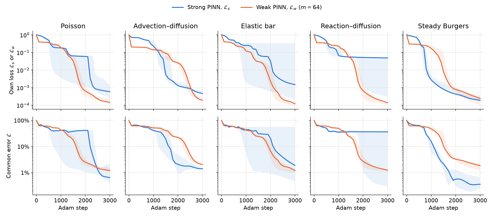
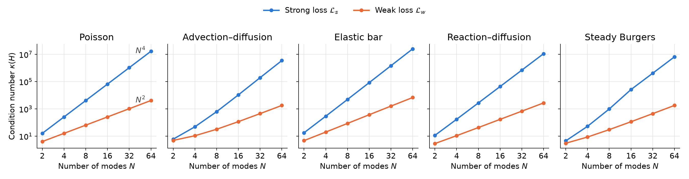
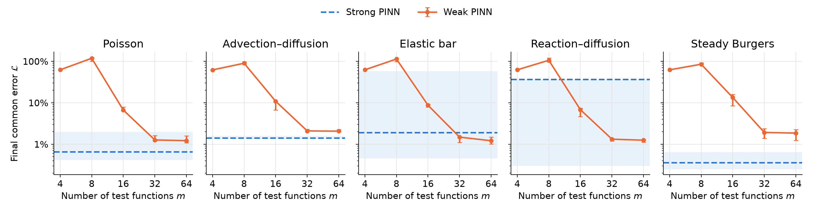

A physics-informed neural network (PINN) approximates the solution of a PDE by a network $u_\theta$ trained to minimize a residual. The **strong** loss $\mathcal L_s$ evaluates the differential equation pointwise, as in the original [PINNs](https://maziarraissi.github.io/PINNs/). The **weak** loss $\mathcal L_w$ tests the equation against functions and moves derivatives onto them by integration by parts, as in [variational PINNs](https://arxiv.org/abs/1912.00873). This post makes the difference precise for the Poisson problem, explains why the weak loss is better conditioned, and compares both losses with one common error $\mathcal L$ on five PDEs. The [code](https://github.com/dani2442/dani2442_code/tree/main/strong-weak-pinns) reproduces every figure. For an introduction to PINNs, see the [earlier post]().

## 1. Strong and weak losses

Let $\Omega\subset\mathbb R^d$ be a bounded Lipschitz domain and $f\in L^2(\Omega)$. The Poisson problem is

$$
\begin{cases}
-\Delta u = f & \text{in }\Omega,\\
u = 0 & \text{on }\partial\Omega.
\end{cases}
$$

Its natural space is $V=H_0^1(\Omega)$ with the energy inner product and norm

$$
(u,v)_V=\int_\Omega\nabla u\cdot\nabla v\,dx,
\qquad
\|v\|_V=\|\nabla v\|_{L^2} .
$$

The network $u_\theta\in V$ is built to satisfy the boundary condition exactly, and $e=u_\theta-u$ denotes its error.

**Strong loss.** Insert $u_\theta$ into the equation and measure the pointwise residual in $L^2$:

$$
r_\theta=-\Delta u_\theta-f=-\Delta e,
\qquad
\mathcal L_s=\|r_\theta\|_{L^2}^2 .
$$

This needs second derivatives of the network.

**Weak loss.** Multiply the equation by a test function $v\in V$ and integrate by parts. The boundary term vanishes and the residual becomes a linear functional on $V$:

$$
\mathcal R_\theta(v)=\int_\Omega\nabla u_\theta\cdot\nabla v-fv\,dx=(e,v)_V .
$$

Only first derivatives of $u_\theta$ appear. The size of a functional is its dual norm, and by Cauchy–Schwarz, with equality at $v=e$,

$$
\boxed{\;
\mathcal L_w=\|\mathcal R_\theta\|_{V'}^2
=\sup_{v\neq0}\frac{|\mathcal R_\theta(v)|^2}{\|v\|_V^2}
=\|e\|_V^2 .\;}
$$

The weak loss *is* the squared energy error. Both losses vanish only at the solution, but they weight the error differently. Since $\mathcal R_\theta(v)=\int_\Omega r_\theta v\,dx$, Cauchy–Schwarz and Poincaré's inequality $\|v\|_{L^2}\le C_P\|v\|_V$ give

$$
\mathcal L_w\le C_P^2\,\mathcal L_s ,
$$

with no reverse bound: $\mathcal L_w$ measures the same residual in a weaker norm, so oscillatory errors count much less than in $\mathcal L_s$. The next section quantifies this.

## 2. Conditioning

Let $\{\phi_k\}$ be the $L^2$-orthonormal eigenfunctions of the Dirichlet Laplacian, $-\Delta\phi_k=\lambda_k\phi_k$, and expand the error as $e=\sum_k e_k\phi_k$. Then

$$
\mathcal L_s=\sum_k\lambda_k^2e_k^2,
\qquad
\mathcal L_w=\sum_k\lambda_ke_k^2 .
$$

Restricted to the first $N$ modes, both losses are quadratics in the coefficients $(e_1,\dots,e_N)$ with diagonal Hessians $H_s=2\operatorname{diag}(\lambda_k^2)$ and $H_w=2\operatorname{diag}(\lambda_k)$. On $\Omega=(0,1)$, where $\lambda_k=(k\pi)^2$,

$$
\boxed{\;\kappa(H_s)=N^4,\qquad\kappa(H_w)=N^2 .\;}
$$

**Lower conditioning is better.** Gradient descent with the largest stable step $1/h_N$ contracts mode $k$ by the factor $1-h_k/h_N$ per step, so the slowest mode $k=1$ needs about $\kappa$ steps to shrink by a constant factor. For $N=16$ that is $65{,}536$ steps for the strong loss against $256$ for the weak one; momentum methods improve both to roughly $\sqrt\kappa$ without changing the ordering. The same fact in operator form: with $A=-\Delta:V\to V'$,

$$
\|\mathcal R_\theta\|_{V'}^2=\langle\mathcal R_\theta,A^{-1}\mathcal R_\theta\rangle ,
$$

so the weak loss is the strong residual preconditioned by the inverse Laplacian.

The caveat is that these are Hessians in the coefficients of $e$. Composed with a network, the loss in $\theta$ is nonconvex and its Hessian $J^\top HJ+\dots$ also depends on the network Jacobian $J$ and on the optimizer, so a better-conditioned $H$ helps but does not guarantee faster training. Section 4 checks what survives.

## 3. Beyond Poisson

The recipe is the same for any PDE: multiply by $v$, integrate the highest-order term by parts, and measure the result in the dual norm. Lower-order and nonlinear terms are simply integrated against $v$.

| Problem | Strong residual $r_\theta$ | Weak residual $\mathcal R_\theta(v)$ |
| --- | --- | --- |
| Poisson | $-\Delta u_\theta-f$ | $\int_\Omega\nabla u_\theta\cdot\nabla v-fv\,dx$ |
| Advection–diffusion | $-\nu u_\theta''+au_\theta'-f$ | $\int\nu u_\theta'v'+au_\theta'v-fv\,dx$ |
| Linear elasticity | $-\nabla\cdot\sigma(u_\theta)-f$ | $\int_\Omega\sigma(u_\theta):\varepsilon(v)-f\cdot v\,dx-\int_{\Gamma_N}t\cdot v\,ds$ |
| Reaction–diffusion | $-\Delta u_\theta+u_\theta^3-f$ | $\int_\Omega\nabla u_\theta\cdot\nabla v+u_\theta^3v-fv\,dx$ |
| Steady Burgers | $-\nu u_\theta''+u_\theta u_\theta'-f$ | $\int\nu u_\theta'v'-\tfrac12u_\theta^2v'-fv\,dx$ |

In every row the weak residual needs one derivative less of $u_\theta$, and for elasticity the traction $t$ on the Neumann boundary $\Gamma_N$ enters as a boundary integral instead of a penalty term. The nonlinear rows follow the same recipe: the cubic term needs no derivative at all, and writing $u_\theta u_\theta'=\tfrac12(u_\theta^2)'$ in Burgers moves even that derivative onto $v$. The conditioning argument of Section 2 then applies to the linearization about the solution.

## 4. Experiments

The five rows of the table are posed on $(0,1)$ with $u(0)=u(1)=0$ and the same manufactured solution

$$
u^\star(x)=\sin(\pi x)+0.1\sin(8\pi x),
$$

whose eighth mode has small amplitude but carries $39\%$ of the energy $\|u^\star\|_V^2$. The forcing $f=Au^\star$ is computed for

- **Poisson**: $Au=-u''$;
- **Advection–diffusion**: $Au=-\nu u''+au'$ with $\nu=0.1$ and $a=1$;
- **Elastic bar**: $Au=-(Eu')'$ with stiffness $E(x)=1+x$, the one-dimensional case of the elasticity row;
- **Reaction–diffusion**: $Au=-u''+u^3$;
- **Steady Burgers**: $Au=-\nu u''+uu'$ with $\nu=0.1$, trained in the conservative weak form of the table.

The network is $u_\theta(x)=x(1-x)N_\theta(2x-1)$, with $N_\theta$ a tanh network of two hidden layers of width 32, so the boundary condition is exact. Both losses share 256-point Gauss–Legendre quadrature, full-batch Adam at learning rate $10^{-3}$, 3,000 steps, float64, and three seeds that give identical initial parameters to both losses. The implemented objectives are

$$
\mathcal L_s=\frac{\|Au_\theta-f\|_{L^2}^2}{\|f\|_{L^2}^2},
\qquad
\mathcal L_w=\frac{1}{\|f\|_{V'}^2}\sum_{k=1}^m\frac{\mathcal R_\theta(\phi_k)^2}{\lambda_k},
$$

with sine tests $\phi_k=\sqrt2\sin(k\pi x)$ and $\lambda_k=\|\phi_k\|_V^2=(k\pi)^2$. The sum is exactly $\|\mathcal R_\theta\|_{V'}^2$ restricted to the span of the first $m$ tests (Appendix A); the denominators only make both losses dimensionless. The common error is

$$
\mathcal L=\frac{\|u_\theta-u^\star\|_V}{\|u^\star\|_V},
$$

evaluated on an independent 512-point rule. Training never sees $u^\star$, and the final iterate is reported.

### 4.1 Strong against weak



*Medians over three paired seeds, shaded min–max. Top: each method's own loss. Bottom: the common error $\mathcal L$.*

Neither loss wins everywhere. Where both converge, the strong PINN ends somewhat lower, below $1\%$ on Poisson and Burgers against $1$–$2\%$ for the weak PINN, and it is clearly faster on the two problems with $\nu=0.1$, advection–diffusion and Burgers. The weak PINN, in turn, converges in every one of its fifteen runs with a narrow band on every problem, while the strong PINN lingers near $40\%$ error for up to 2,000 steps and never leaves that plateau in one of three seeds on the elastic bar and in two of three on reaction–diffusion (final errors of $58\%$ and $36\%$, hence the wide bands and the high reaction–diffusion median). The top row also shows that the own losses are different objects. $\mathcal L_s$ is a squared residual. For Poisson, $\mathcal L_w$ is the squared common error restricted to the test space, and with $m=64$ the untested remainder is negligible, so $\mathcal L_w\approx\mathcal L^2$ and a weak loss of $10^{-4}$ reads as a $1\%$ error; the other four problems stay within a factor of two of this reading.

### 4.2 Conditioning



*Condition number of the Hessian of each loss at $u^\star$ in the first $N$ sine coefficients; no network is involved. For Poisson the curves are exactly $N^4$ and $N^2$.*

The condition numbers grow as $N^4$ for the strong loss and $N^2$ for the weak loss on all five problems: exactly for Poisson, asymptotically for the others, whose first-order, variable-coefficient, and nonlinear terms only matter at the lowest modes. At $N=64$ the two losses are three to four orders of magnitude apart on every problem. This confirms the mechanism of Section 2 for nonsymmetric, variable-coefficient, and nonlinear operators, the latter through their linearization at $u^\star$; Section 4.1 shows how much of it survives Adam and the network parameterization.

### 4.3 How many test functions?



*Final common error $\mathcal L$ of the weak PINN against the number of sine tests $m$, medians and min–max over three seeds. The dashed line and band are the strong PINN.*

The number of tests decides everything, and the picture is the same on all five problems. With $m=4$ the eighth mode of $u^\star$ is never tested: the loss falls below $10^{-13}$ and the error is exactly that of dropping the mode, $\sqrt{0.64/1.64}=62.5\%$. With $m=8$ every mode of $u^\star$ is tested, yet the error is near or above $100\%$: the network adds oscillations above the eighth mode that no test penalizes, so the optimizer has no reason to remove them. From $m=16$ the tests start to control what the network can produce, at $m=32$ the weak PINN reaches about $1$–$2\%$ on every problem, and doubling to $m=64$ changes nothing. The strong reference sits below that plateau on Poisson, advection–diffusion, and Burgers, and above it with a very wide band on the bar and reaction–diffusion, where it has stuck seeds. The tests must cover the frequencies the network can generate, not only those present in the data; a vanishing training loss certifies nothing about the untested directions.

## 5. Conclusion

The weak loss needs one derivative less, measures the residual in a weaker norm, and for Poisson equals the squared energy error. This lowers the Hessian condition number from $N^4$ to $N^2$, for Poisson exactly and for the other four problems asymptotically, and lower conditioning is better: gradient methods contract the slow modes in proportionally fewer steps. In the neural experiments the advantage appears as robustness rather than accuracy. With enough test functions the weak PINN converged in every run to about $1$–$2\%$ error on all five problems, with a loss that reads as the squared error, while the strong PINN got stuck in three of its fifteen runs; where it did converge it was somewhat more accurate, and on the two problems with weak diffusion also faster. Adam and the network Jacobian blur the $N^4$ versus $N^2$ gap. The price on the weak side is the number of test functions: fewer than the frequencies the network can reach, and the loss goes to zero while the error does not.

## Appendix A: finite test functions

Given tests $v_1,\dots,v_m\in V$ spanning $V_m$, set $b_i=\mathcal R_\theta(v_i)$ and $G_{ij}=(v_i,v_j)_V$. For $v=\sum_ic_iv_i$ we have $\mathcal R_\theta(v)=c^\top b$ and $\|v\|_V^2=c^\top Gc$, so the dual norm over $V_m$ is

$$
\mathcal L_{w,m}
=\sup_{v\in V_m\setminus\{0\}}\frac{|\mathcal R_\theta(v)|^2}{\|v\|_V^2}
=b^\top G^{-1}b
=\|P_me\|_V^2 ,
$$

where $P_m$ is the $V$-orthogonal projection onto $V_m$. Three consequences:

- **Basis independence.** A change of basis $S$ maps $b\mapsto S^\top b$ and $G\mapsto S^\top GS$ and leaves $b^\top G^{-1}b$ unchanged. The unweighted alternative $b^\top b$ has no such invariance; for sine tests it equals $\sum_{k\le m}\lambda_k^2e_k^2$, the weighting of the strong loss again.
- **Sine tests.** $G=\operatorname{diag}(\lambda_k)$, so $\mathcal L_{w,m}=\sum_{k\le m}\lambda_ke_k^2$, the formula trained in Section 4.
- **Invisible directions.** $\mathcal L_{w,m}\le\mathcal L_w=\|e\|_V^2$, and the gap $\|(I-P_m)e\|_V^2$ is invisible to training: an error $e=a\sin(K\pi x)$ with $K>m$ has zero loss. The tests must control every frequency the network can produce, not only those present in $f$. Section 4.3 shows what happens otherwise.

## Appendix B: reproduction

From the repository root, with NumPy, Matplotlib, and CPU PyTorch:

```bash
python code/strong-weak-pinns/experiment.py              # validate, train 90 runs, plot
python code/strong-weak-pinns/experiment.py --plot-only  # figures from saved results
```

Before training, the script asserts to $10^{-8}$ or tighter that the manufactured solution satisfies each PDE, that integration by parts holds on the quadrature rule, that the sine Gram matrix is $\operatorname{diag}(\lambda_k)$ and $b^\top G^{-1}b$ is invariant under a random change of basis, that an error in mode 8 is invisible to four tests yet has its full energy, that parameter gradients match central finite differences, and that the Poisson condition numbers are exactly $N^4$ and $N^2$. After training, every model is re-evaluated with doubled quadrature and no error moves by more than $10^{-5}$ relatively. Settings and library versions are recorded in the results directory, and the [README](https://github.com/dani2442/dani2442_code/blob/main/strong-weak-pinns/README.md) lists the outputs.

## References

- Raissi, M., Perdikaris, P., and Karniadakis, G. E. (2019). [Physics-informed neural networks: A deep learning framework for solving forward and inverse problems involving nonlinear partial differential equations](https://doi.org/10.1016/j.jcp.2018.10.045). *Journal of Computational Physics*, 378, 686–707.
- Kharazmi, E., Zhang, Z., and Karniadakis, G. E. (2019). [Variational Physics-Informed Neural Networks for Solving Partial Differential Equations](https://arxiv.org/abs/1912.00873).
- E, W. and Yu, B. (2018). [The Deep Ritz Method: A Deep Learning-Based Numerical Algorithm for Solving Variational Problems](https://arxiv.org/abs/1710.00211). *Communications in Mathematics and Statistics*, 6, 1–12. For symmetric problems the weak loss equals the excess Dirichlet energy, which Deep Ritz minimizes directly without test functions.
